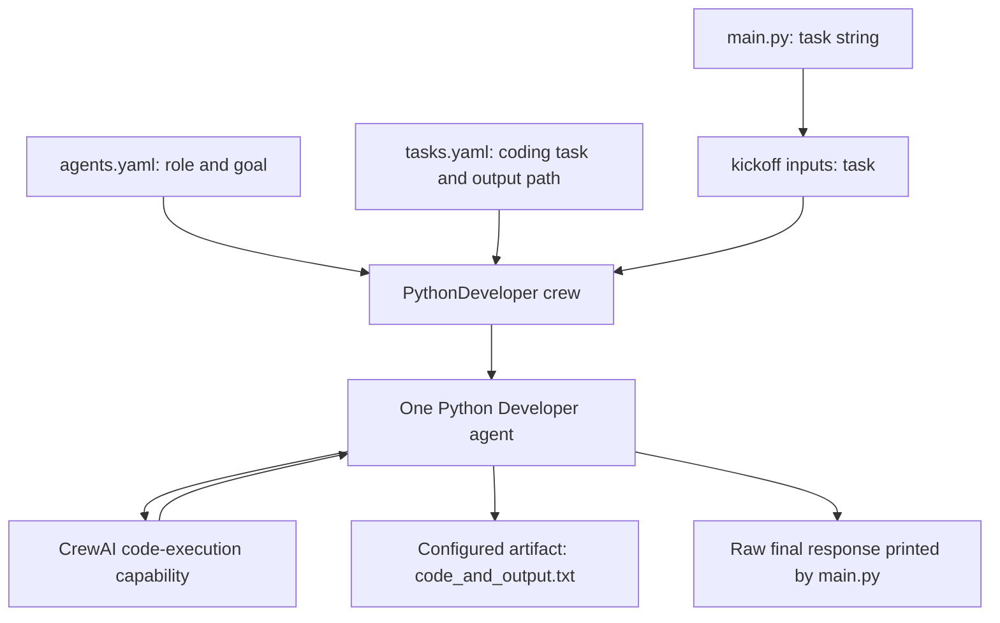

# Python Developer Agent

### From a task description to an execution-backed code artifact

A **CrewAI-based Python coding-agent prototype** configured to interpret a task, plan an approach, write Python, run the code, and deliver a text artifact containing the implementation and its output.

The project explores the step beyond code generation: giving an LLM access to a code-execution tool so it can inspect computational output before preparing its answer. Agent behavior and task expectations live in YAML, orchestration lives in Python, and dependency resolution is captured in a committed `uv.lock`.

[Agent orchestration](./python_developer/src/python_developer/crew.py) · [Task configuration](./python_developer/src/python_developer/config/tasks.yaml) · [Entry point](./python_developer/src/python_developer/main.py)

> **Project stage:** Single-agent prototype with one configured coding task. Source review identified configuration issues that need correction before a dependable run. No generated artifact, execution transcript, or automated correctness evidence is committed. The project was not executed for this documentation.

---

## The problem this project explores

Generating a code snippet is only one part of solving a programming task. A useful workflow also needs to execute the program, inspect its result, and package the implementation with enough context for a person to review it.

This project expresses that workflow as a configurable coding agent:

1. Receive a natural-language task.
2. Plan the implementation, as instructed by the agent goal.
3. Write Python and use the framework's code-execution capability.
4. Check the output, as requested in the prompt.
5. Save a final code-and-output response to a text file.

These steps are instructions and capabilities configured in the source. There is no separate application-level state machine enforcing each step or independent validator confirming that the generated program is correct.

## Intended business value

| Development need | Project design |
|---|---|
| Turn a bounded computational request into an implementation | A task description is injected into the agent goal and coding task |
| Inspect results alongside generated code | Code execution is enabled; the requested artifact includes code and output |
| Reuse the workflow for another task | The task string in `main.py` supplies the runtime input |
| Keep behavior separate from orchestration | YAML defines role and task; Python constructs the agent and crew |
| Set execution constraints | Agent execution-time and retry settings are explicitly configured |
| Make environment setup more reproducible | Python version constraint, project metadata, and a committed lockfile |

Potential applications include small calculations, programming exercises, and bounded automation experiments after the configuration is repaired and execution is evaluated. Developer time saved, task success rate, and output correctness have not been measured.

## Included example: approximate π with a finite series

The default task asks the agent to calculate the first **10,000 terms** of the alternating series and multiply their sum by four:

```text
4 × (1 − 1/3 + 1/5 − 1/7 + …)
```

This corresponds to the finite sum:

```text
4 × Σ[k = 0 … 9,999] ((−1)^k / (2k + 1))
```

It is a useful bounded demonstration because a reviewer can inspect the loop, term count, alternating signs, and numerical result against an independently calculated reference.

**What is committed:** The natural-language task and the orchestration required to submit it to the agent.

**What is not committed:** A generated solution, the resulting numerical value, or an assertion comparing it with a reference. No successful-run claim is inferred from the task definition alone.

## Architecture



The diagram shows the configured workflow; startup issues described below currently need attention. Although CrewAI supports multiple agents, this project constructs **one agent and one task** using `Process.sequential`. It does not implement a developer-reviewer team.

### Agent configuration

| Setting in `crew.py` | Configured value | Purpose |
|---|---|---|
| `allow_code_execution` | `True` | Enables framework code-execution support |
| `code_execution_mode` | `safe` | Requests the framework's Docker-based execution mode |
| `max_execution_time` | `300` | Sets the agent task execution-time limit in seconds |
| `max_retry_limit` | `7` | Sets the agent's error retry limit |
| `verbose` | `True` | Enables detailed framework output |
| Crew process | `Process.sequential` | Uses sequential task execution |

These settings configure framework behavior. They are not proof of successful execution, guaranteed termination of every subprocess, or a complete security boundary. The meanings above follow the [CrewAI 0.130.0 agent implementation](https://github.com/crewAIInc/crewAI/blob/0.130.0/src/crewai/agent.py), which matches the locked framework version.

Planning is expressed in the agent's goal text. The source does not enable a separate framework reasoning mode or implement an independent review stage.

### Artifact contract

The task requests a text file containing:

- The generated Python code.
- The output of that code.

Its configured destination is:

```text
output/code_and_output.txt
```

When launched from the `python_developer` project directory, this is the intended relative output location. `main.py` also prints `result.raw` after crew completion. The text file is an agent-produced report; no structured output schema or independent code-to-output consistency check is implemented.

## Repository structure

```text
Python-Developer-Agent/
├── README.md
└── python_developer/
    ├── README.md
    ├── pyproject.toml
    ├── uv.lock
    ├── knowledge/
    │   └── user_preference.txt
    └── src/python_developer/
        ├── __init__.py
        ├── main.py
        ├── crew.py
        ├── config/
        │   ├── agents.yaml
        │   └── tasks.yaml
        └── tools/
            ├── __init__.py
            └── custom_tool.py
```

### Source guide

| File | Responsibility |
|---|---|
| `main.py` | Defines the example task, invokes the crew, prints its raw result, and wraps exceptions |
| `crew.py` | Creates the code-enabled agent, coding task, and sequential crew |
| `config/agents.yaml` | Defines the Python Developer role, goal, backstory, and intended model string |
| `config/tasks.yaml` | Defines the task prompt, expected report, agent assignment, and artifact path |
| `pyproject.toml` | Defines Python compatibility, dependencies, build system, and console scripts |
| `uv.lock` | Captures dependency resolution, including CrewAI `0.130.0` |
| `tools/custom_tool.py` | Contains a scaffold example tool; it is not attached to the configured agent |
| `knowledge/user_preference.txt` | Contains template profile text; no knowledge source is wired into the crew |

The custom tool and preference file are scaffolding, not delivered custom execution tooling or active personalized memory.

## Current configuration issues

### 1. YAML paths do not match the committed layout

`crew.py` declares:

```python
agents_config = 'agents.yaml'
tasks_config = 'tasks.yaml'
```

The committed files are inside `config/`. The locked framework resolves these paths relative to the crew class's directory, so the configured paths omit the required `config/` component. This can leave configuration dictionaries empty and cause the subsequent key lookups to fail. See the [version-matched CrewBase loader](https://github.com/crewAIInc/crewAI/blob/0.130.0/src/crewai/project/crew_base.py).

### 2. The intended model is not bound through `llm`

`agents.yaml` contains:

```yaml
model: groq/llama-3.1-70b-versatile
```

The locked CrewAI agent exposes its model through `llm`, and the Python agent constructor does not pass an explicit `llm` argument. The existing `model` entry should not be treated as proof that Groq is selected. Correct the binding and verify a currently supported model identifier before execution.

The nested README's generic `OPENAI_API_KEY` instruction is template text, not evidence that the intended Groq configuration is operational.

### 3. Some console scripts reference missing functions

`python_developer` and `run_crew` both target the implemented `run()` function. The `train`, `replay`, and `test` script entries target functions that are absent from `main.py`.

### 4. No independent acceptance checks are included

There is no committed output artifact, automated test suite, numerical tolerance check, or evaluator establishing that the agent completed the task correctly. An instruction to check output is not equivalent to an implemented correctness assertion.

## Environment and development setup

The project declares:

- Python `>=3.10,<3.14`.
- `crewai[tools]>=0.130.0,<1.0.0`.
- Hatchling as the build backend.
- A `uv.lock` resolving CrewAI `0.130.0`.
- Docker-based execution through the configured safe mode.

### Preparation

1. Clone the repository and enter the inner project directory:

   ```bash
   git clone https://github.com/FaiazS/Python-Developer-Agent.git
   cd Python-Developer-Agent/python_developer
   ```

2. Use a supported Python version and install the locked environment with uv:

   ```bash
   uv sync --locked
   ```

3. Correct the YAML paths and bind the intended model through the supported configuration field.
4. Configure credentials for the selected provider outside source control. If Groq is selected, configure `GROQ_API_KEY` and verify model availability.
5. Ensure Docker is installed and running for the configured code-execution mode.
6. Review the task and execution environment before starting a model-generated code run.

After addressing the configuration issues, the implemented console entry point is:

```bash
uv run run_crew
```

This command is provided as the intended development entry point, not as a verified successful run of the current checkout. Running it invokes a model and can execute generated code. No installation, model invocation, Docker execution, or tests were performed for this README.

## Next engineering milestones

1. **Repair startup configuration:** Align file paths, model binding, credentials, and supported console scripts.
2. **Capture a reproducible demonstration:** Commit a sanitized task, generated code, execution transcript, dependency information, and resulting artifact.
3. **Add deterministic acceptance checks:** Independently compute the series reference and assert a defined numerical tolerance and term count.
4. **Separate task input from source edits:** Add a validated CLI argument or task file instead of changing a module-level string.
5. **Validate the artifact:** Require structured code, execution status, stdout, stderr, and validation results rather than relying only on free text.
6. **Define execution boundaries:** Specify container resources, network access, filesystem access, timeouts, and cleanup for generated programs.
7. **Measure usefulness:** Evaluate a bounded task set for success rate, retries, latency, model cost, and human review effort.

These are proposed improvements. The repository does not currently provide a hosted coding service, repository-wide editing, pull-request automation, a multi-agent review pipeline, or production deployment.

## What this project demonstrates

This project shows my move from prompting for code toward designing a workflow around code generation: a declared task, a specialized agent, execution capability, runtime limits, and a reviewable artifact contract.

The engineering direction is practical—connect natural-language requirements to executable work—while the next step is equally concrete: repair configuration and establish independent evidence that the generated program does what the task requires.

---

**Author:** [Faiaz Ahmed](https://www.linkedin.com/in/faiazahmed22/) · [GitHub](https://github.com/FaiazS)
